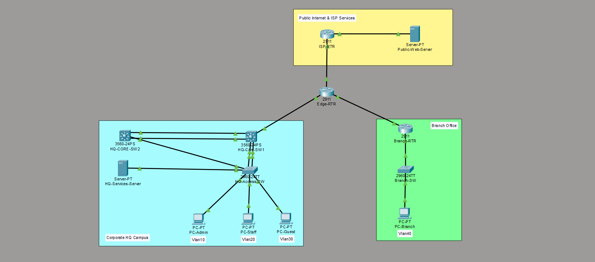

# Enterprise Multi-Site Campus & Secure Edge Network Architecture

A complete, resilient enterprise network architecture designed, simulated, and validated in **Cisco Packet Tracer**.

This project demonstrates production-grade campus redundancy, dynamic multi-site routing, centralized network services, edge NAT/PAT translation, and policy-based security segmentation.



---

## Key Technologies & Architecture Highlights

### 1. High Availability & Layer 2 Resiliency

- **Dual-Core Gateway Redundancy (HSRP):** Configured Hot Standby Router Protocol across `HQ-Core-SW1` (Active, priority 110 with preempt) and `HQ-Core-SW2` (Standby) providing seamless virtual gateway failover (`10.10.x.1`).
- **LACP EtherChannel:** Bundled physical uplinks into 2 Gbps active 802.1Q trunks (`Port-channel 1` and `Port-channel 2`) for switch link redundancy and load balancing.
- **Rapid Spanning Tree Protocol (Rapid-PVST+):** Hardened loop prevention featuring deterministic root bridge priorities, **PortFast** on all end-user ports, and **BPDU Guard** to prevent unauthorized switch attachments.

### 2. Multi-Site Dynamic Routing (OSPFv2)

- **Single-Area OSPF (Area 0):** Interconnects HQ Campus, Branch Office, and the Edge WAN perimeter over point-to-point `/30` routed subnets.
- **Route Optimization:** Applied `passive-interface` on all user-facing LAN segments (SVIs and RoaS sub-interfaces) to eliminate unnecessary hello broadcast traffic.
- **Default Route Propagation:** Injected dynamic default route (`0.0.0.0/0`) via `default-information originate` from the Edge router out to the simulated Internet.

### 3. Core Enterprise IP Services

- **Centralized DHCP Relay:** Configured centralized DHCP pools on HQ Core for all four corporate subnets, leveraging `ip helper-address` on `Branch-RTR`'s sub-interface (`Gig0/1.40`) to relay DHCP discovery broadcasts across the WAN.
- **Centralized Management (NTP, Syslog, AAA):**
  - **NTP:** Synchronized system clocks across all routers and switches to `HQ-Services-Server`.
  - **Syslog:** Redirected console events and link flaps to a centralized logging server via UDP 514.
  - **AAA (RADIUS):** Enabled centralized administrative authentication with local fallback.
- **DNS & Web Services:** Integrated simulated external public DNS and web resolution.

### 4. Edge Perimeter Security & Segmentation

- **Dynamic NAT / PAT (Overload):** Translates internal RFC 1918 private subnets (`10.10.0.0/16`) to public IP space (`203.0.113.1`) for external communication.
- **Security ACLs:** Deployed an Extended Access Control List on the Guest SVI to restrict guest users from reaching internal corporate subnets while permitting outbound web access.
- **Device Hardening:** Enforced SSH (v2) remote management and disabled unencrypted Telnet across `line vty`.

---

## IP Addressing Plan

| Segment / Purpose           | VLAN | Network ID       | Subnet Mask       | Gateway IP (HSRP VIP) | Description                   |
| :-------------------------- | :--: | :--------------- | :---------------- | :-------------------- | :---------------------------- |
| **HQ Admin**                |  10  | `10.10.10.0/24`  | `255.255.255.0`   | `10.10.10.1`          | Management & Core Services    |
| **HQ Staff**                |  20  | `10.10.20.0/24`  | `255.255.255.0`   | `10.10.20.1`          | Internal Corporate Users      |
| **HQ Guest**                |  30  | `10.10.30.0/24`  | `255.255.255.0`   | `10.10.30.1`          | Isolated Internet-Only Access |
| **Branch Office**           |  40  | `10.10.40.0/24`  | `255.255.255.0`   | `10.10.40.1`          | Remote Office (RoaS)          |
| **WAN: HQ to Edge**         |  -   | `10.10.100.0/30` | `255.255.255.252` | Point-to-Point        | Routed WAN link               |
| **WAN: Branch to Edge**     |  -   | `10.10.100.4/30` | `255.255.255.252` | Point-to-Point        | Routed WAN link               |
| **Public WAN: Edge to ISP** |  -   | `203.0.113.0/30` | `255.255.255.252` | Point-to-Point        | Internet Gateway Link         |
| **Public DMZ / Web Server** |  -   | `203.0.113.8/29` | `255.255.255.248` | `203.0.113.9`         | External Public Web & DNS     |

---

## Repository Structure

```text
cisco-enterprise-network/
│
├── README.md                      # Network documentation and architecture overview
├── topology.png                   # High-resolution network diagram
├── enterprise-network.pkt         # Cisco Packet Tracer lab file
│
└── configs/                       # Exported running-config files
    ├── HQ-Core-SW1.txt
    ├── HQ-Core-SW2.txt
    ├── HQ-Access-SW.txt
    ├── Edge-RTR.txt
    └── Branch-RTR.txt

```

---

## Verification & Troubleshooting Commands Used

- `show standby brief` — Validated HSRP state (`Active` on Core 1, `Standby` on Core 2) and Virtual IP assignment.
- `show ip ospf neighbor` — Verified FULL neighbor adjacency between HQ, Edge, and Branch routers.
- `show ip route` — Confirmed dynamic route exchange across all subnets and verified the `O*E2` default route.
- `show etherchannel summary` — Confirmed active LACP bundle status `(SU)` and member port synchronization.
- `show ip nat translations` — Inspected real-time PAT translation sessions under active traffic.
- `show access-lists` — Audited packet match counters for Guest VLAN policy enforcement.
- `show ntp status` & `show clock` — Verified synchronized time across all network nodes.
